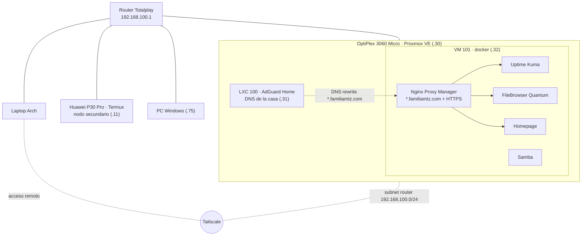

# Homelab

Servidor casero con Proxmox VE que da DNS con bloqueo de anuncios y contenido para toda la casa, servicios en Docker con nombres y HTTPS propios, acceso remoto por Tailscale, monitoreo y respaldos automáticos. Un Huawei P30 Pro con Termux funciona como nodo secundario.

Ningún servicio está expuesto a internet: todo se accede desde la red de casa o por Tailscale.

## Arquitectura



## Máquinas

| Máquina | Rol | IP LAN |
| --- | --- | --- |
| OptiPlex 3060 Micro (`pve`) | Host Proxmox VE 9 · i5-8500T, 16 GB, SSD 256 GB | 192.168.100.30 |
| LXC 100 `adguard` | AdGuard Home (Debian 13) | 192.168.100.31 |
| VM 101 `docker` | Servicios en Docker (Debian 13, 4 núcleos, 6 GB) | 192.168.100.32 |
| Huawei P30 Pro | Nodo secundario en Termux: SSH, bot de Discord, respaldos | 192.168.100.11 |
| PC Windows | PC principal, despierta por Wake-on-LAN | 192.168.100.75 |

Las IPs fijas son reservas DHCP en el router.

## Servicios

| Nombre | Servicio | Qué hace |
| --- | --- | --- |
| `inicio.familiamtz.com` | Homepage | Página de inicio con accesos y clima |
| `archivos.familiamtz.com` | FileBrowser Quantum | Buzón de archivos por web |
| `kuma.familiamtz.com` | Uptime Kuma | Monitoreo, alertas a ntfy |
| `adguard.familiamtz.com` | AdGuard Home | DNS con bloqueo de anuncios, NSFW y Safe Search |
| `proxmox.familiamtz.com` | Proxmox VE | Panel del servidor |
| `npm.familiamtz.com` | Nginx Proxy Manager | Proxy inverso y certificados |

Cómo funcionan los nombres: AdGuard responde `*.familiamtz.com` con la IP de la VM, y Nginx Proxy Manager reparte cada nombre a su servicio con un certificado comodín de Let's Encrypt (validación por DNS de Cloudflare, renovación automática). Fuera de casa funciona igual porque el DNS de Tailscale apunta a AdGuard.

El buzón (`~/compartido` en la VM) también se accede por Samba como unidad de red en Windows y con las funciones de `dotfiles/homelab.zsh` desde la terminal.

## Estructura del repo

```
homelab/
├── docker/              compose.yaml de cada servicio
│   ├── filebrowser/     + config.yaml (va en data/config.yaml)
│   ├── homepage/        + config/ (servicios, widgets, ajustes)
│   ├── npm/
│   └── uptime-kuma/
├── samba/               smb.conf de la VM
├── scripts/             scripts de la VM docker + crontab
├── p30/                 nodo P30: scripts, arranque de Termux, sshd_config, crontab
└── dotfiles/            funciones del buzón y wakeup para zsh
```

## Respaldos

| Nivel | Qué | Cuándo | Dónde |
| --- | --- | --- | --- |
| Proxmox | LXC y VM completos (snapshot, ZSTD) | Diario 03:00, últimos 7 | Disco local del servidor |
| P30 | Configuración del nodo | Diario 03:30 | Google Drive (30 días) |
| Buzón | `~/compartido` con `rclone sync` | Diario 04:00 | Google Drive, con versiones anteriores 30 días |

Cada script de respaldo avisa a Uptime Kuma con un monitor Push; si no llega el aviso en 25 horas, Kuma manda alerta.

## Secretos (no están en el repo)

Este repo guarda cómo está armado todo, no los datos ni las credenciales. Para reconstruir hace falta:

| Qué | Dónde vive | Cómo recuperarlo |
| --- | --- | --- |
| URLs Push de Kuma | `~/.config/homelab/push.env` en la VM y en el P30 | Copiar de Kuma; ver `push.env.example` |
| Acceso a Google Drive | `rclone.conf` en la VM y en el P30 | `rclone config` |
| Token de Cloudflare (DNS) | Nginx Proxy Manager | Gestor de contraseñas |
| Datos de NPM, Kuma y FileBrowser | `data/` de cada servicio | Respaldo de Proxmox de la VM 101 |
| Configuración de AdGuard | `/opt/AdGuardHome/AdGuardHome.yaml` | Respaldo de Proxmox del LXC 100 |

## Restaurar un servicio

```bash
ssh docker
mkdir -p ~/stacks/<servicio>
cp ~/homelab/docker/<servicio>/compose.yaml ~/stacks/<servicio>/
cd ~/stacks/<servicio> && docker compose up -d
```

Para FileBrowser, copiar además `config.yaml` a `~/stacks/filebrowser/data/config.yaml`. Para Homepage, copiar la carpeta `config/`.

## Pendientes

- Segundo módulo de 16 GB de RAM (dual channel).
- Disco de 2.5" para sacar los respaldos de Proxmox del mismo SSD.
- Monitor externo (Healthchecks.io) que avise si el servidor completo se cae.
- Cuentas de FileBrowser para la familia, separadas del buzón.
- Immich (fotos) y Jellyfin (películas) con el disco nuevo.
