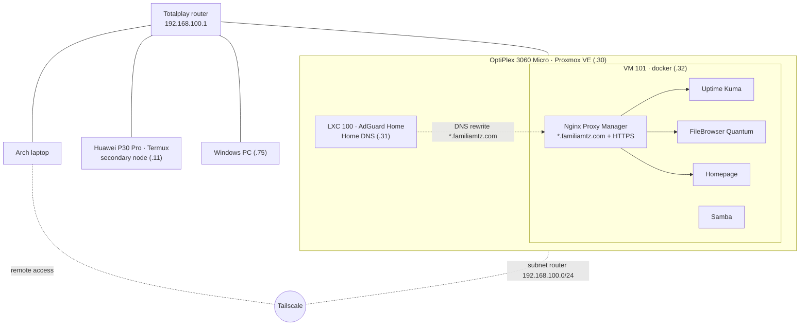

# Homelab

Home server running Proxmox VE that provides network-wide DNS with ad and content blocking, Docker services with their own domain names and HTTPS, remote access through Tailscale, monitoring, and automated backups. A Huawei P30 Pro running Termux acts as a secondary node.

No service is exposed to the internet: everything is reachable only from the home network or through Tailscale.

## Architecture



## Machines

| Machine | Role | LAN IP |
| --- | --- | --- |
| OptiPlex 3060 Micro (`pve`) | Proxmox VE 9 host · i5-8500T, 16 GB RAM, 256 GB SSD | 192.168.100.30 |
| LXC 100 `adguard` | AdGuard Home (Debian 13) | 192.168.100.31 |
| VM 101 `docker` | Docker services (Debian 13, 4 cores, 6 GB RAM) | 192.168.100.32 |
| Huawei P30 Pro | Secondary node on Termux: SSH, Discord bot, backups | 192.168.100.11 |
| Windows PC | Main desktop, woken up with Wake-on-LAN | 192.168.100.75 |

Static IPs are DHCP reservations on the router.

## Services

| Name | Service | Purpose |
| --- | --- | --- |
| `inicio.familiamtz.com` | Homepage | Start page with shortcuts and weather |
| `archivos.familiamtz.com` | FileBrowser Quantum | Web access to the shared file drop |
| `kuma.familiamtz.com` | Uptime Kuma | Monitoring, alerts via ntfy |
| `adguard.familiamtz.com` | AdGuard Home | DNS with ad, NSFW, and Safe Search filtering |
| `proxmox.familiamtz.com` | Proxmox VE | Server dashboard |
| `npm.familiamtz.com` | Nginx Proxy Manager | Reverse proxy and certificates |

How names work: AdGuard resolves `*.familiamtz.com` to the VM's IP, and Nginx Proxy Manager routes each name to its service using a Let's Encrypt wildcard certificate (Cloudflare DNS challenge, automatic renewal). It works the same away from home because Tailscale's DNS points to AdGuard.

The file drop (`~/compartido` on the VM) is also available as a Samba network drive on Windows and through the shell functions in `dotfiles/homelab.zsh`.

## Repository layout

```
homelab/
├── docker/              compose.yaml for each service
│   ├── filebrowser/     + config.yaml (goes in data/config.yaml)
│   ├── homepage/        + config/ (services, widgets, settings)
│   ├── npm/
│   └── uptime-kuma/
├── samba/               smb.conf from the VM
├── scripts/             docker VM scripts + crontab
├── p30/                 P30 node: scripts, Termux boot, sshd_config, crontab
└── dotfiles/            file drop and wakeup functions for zsh
```

## Backups

| Level | What | When | Where |
| --- | --- | --- | --- |
| Proxmox | Full LXC and VM (snapshot, ZSTD) | Daily 03:00, keep last 7 | Server's local disk |
| P30 | Node configuration | Daily 03:30 | Google Drive (30 days) |
| File drop | `~/compartido` via `rclone sync` | Daily 04:00 | Google Drive, previous versions kept 30 days |

Each backup script reports to Uptime Kuma through a Push monitor; if no report arrives within 25 hours, Kuma sends an alert.

## Secrets (not in this repo)

This repo stores how everything is set up, not the data or credentials. To rebuild, you need:

| What | Where it lives | How to recover it |
| --- | --- | --- |
| Kuma Push URLs | `~/.config/homelab/push.env` on the VM and the P30 | Copy from Kuma; see `push.env.example` |
| Network details (PC MAC and IP, AdGuard IPv6) | `~/.config/homelab/red.env` on the VM and the P30 | See `red.env.example` |
| Google Drive access | `rclone.conf` on the VM and the P30 | `rclone config` |
| Cloudflare API token (DNS) | Nginx Proxy Manager | Password manager |
| NPM, Kuma, and FileBrowser data | Each service's `data/` folder | Proxmox backup of VM 101 |
| AdGuard configuration | `/opt/AdGuardHome/AdGuardHome.yaml` | Proxmox backup of LXC 100 |

## Restoring a service

```bash
ssh docker
mkdir -p ~/stacks/<service>
cp ~/homelab/docker/<service>/compose.yaml ~/stacks/<service>/
cd ~/stacks/<service> && docker compose up -d
```

For FileBrowser, also copy `config.yaml` to `~/stacks/filebrowser/data/config.yaml`. For Homepage, copy the `config/` folder.

## Roadmap

- Second 16 GB RAM module (dual channel).
- 2.5" drive to move Proxmox backups off the system SSD.
- External monitor (Healthchecks.io) to alert if the whole server goes down.
- FileBrowser accounts for the family, separate from the file drop.
- Immich (photos) and Jellyfin (movies) once the new drive is in.
