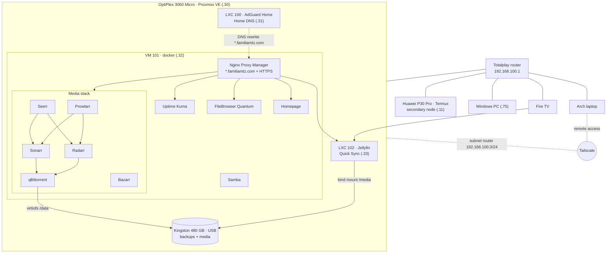

# Homelab

Home server running Proxmox VE that provides network-wide DNS with ad and content blocking, a media server with hardware transcoding, an automated download and subtitle stack, Docker services with their own domain names and HTTPS, remote access through Tailscale, monitoring, automated backups, and automatic updates. A Huawei P30 Pro running Termux acts as a secondary node.

No web interface is exposed to the internet: every dashboard is reachable only from the home network or through Tailscale. The only open port on the router (besides the Nintendo Switch's) is qBittorrent's BitTorrent port.

## Architecture



## Machines

| Machine | Role | LAN IP |
| --- | --- | --- |
| OptiPlex 3060 Micro (`pve`) | Proxmox VE 9 host · i5-8500T (UHD 630), 16 GB RAM, 256 GB system SSD, 480 GB USB SSD for backups and media | 192.168.100.30 |
| LXC 100 `adguard` | AdGuard Home (Debian 13) | 192.168.100.31 |
| VM 101 `docker` | Docker services (Debian 13, 4 cores, 6 GB RAM) | 192.168.100.32 |
| LXC 102 `jellyfin` | Jellyfin with Intel Quick Sync (Debian 13, unprivileged) | 192.168.100.33 |
| Huawei P30 Pro | Secondary node on Termux: SSH, Discord bot, job watcher, backups | 192.168.100.11 |
| Windows PC | Main desktop, woken up with Wake-on-LAN | 192.168.100.75 |

Static IPs are DHCP reservations on the router.

## Services

| Name | Service | Purpose |
| --- | --- | --- |
| `inicio.familiamtz.com` | Homepage | Start page with shortcuts, weather, and live widgets |
| `archivos.familiamtz.com` | FileBrowser Quantum | Web access to the shared file drop |
| `kuma.familiamtz.com` | Uptime Kuma | Monitoring, alerts via ntfy |
| `adguard.familiamtz.com` | AdGuard Home | DNS with ad, NSFW, and Safe Search filtering |
| `proxmox.familiamtz.com` | Proxmox VE | Server dashboard |
| `npm.familiamtz.com` | Nginx Proxy Manager | Reverse proxy and certificates |
| `jellyfin.familiamtz.com` | Jellyfin | Media server for movies, series, and anime |
| `seerr.familiamtz.com` | Seerr | Browse and request movies and series |
| `sonarr.familiamtz.com` | Sonarr | Series and anime automation |
| `radarr.familiamtz.com` | Radarr | Movie automation |
| `prowlarr.familiamtz.com` | Prowlarr | Indexer manager for Sonarr and Radarr |
| `qbittorrent.familiamtz.com` | qBittorrent | Download client |
| `bazarr.familiamtz.com` | Bazarr | Automatic subtitles (Spanish, English fallback) |

How names work: AdGuard resolves `*.familiamtz.com` to the VM's IP, and Nginx Proxy Manager routes each name to its service using a Let's Encrypt wildcard certificate (Cloudflare DNS challenge, automatic renewal). It works the same away from home because Tailscale's DNS points to AdGuard.

## Media stack

1. A movie or series is requested in Seerr (or added directly in Radarr/Sonarr).
2. Radarr or Sonarr searches the indexers managed by Prowlarr and sends the best release to qBittorrent. Quality profiles cap file sizes (about 12 GB for a 2-hour 1080p movie) and reject French-only releases.
3. When the download finishes, it is hardlinked into the library and renamed, so it appears in Jellyfin within minutes without using extra space.
4. Bazarr fetches missing subtitles (Latin American Spanish first, English as a fallback).

All of these share the same `/data` path, which is the `media` folder on the USB SSD:

```
/data
├── anime/
├── peliculas/
├── series/
└── descargas/
```

The folder lives on the Proxmox host and is shared with the VM through **virtiofs** (`/data`) and with the Jellyfin container through a bind mount (`/media`). Jellyfin transcodes with the iGPU (`/dev/dri/renderD128`, Intel Quick Sync); the UHD 630 does not decode AV1, so x264/HEVC releases are preferred.

qBittorrent limits its speed during the day and runs unrestricted from 01:00 to 08:00. Torrents stop seeding at ratio 1.

## File sharing

The file drop (`~/compartido` on the VM) is available through FileBrowser, as a Samba network drive on Windows, and through the shell functions in `dotfiles/homelab.zsh`. The media library (`/data`) is shared over Samba as a second drive to add files by hand.

## Repository layout

```
homelab/
├── docker/              compose.yaml for each service
│   ├── arr/             Prowlarr, Sonarr, Radarr, FlareSolverr, Seerr, Bazarr
│   ├── filebrowser/     + config.yaml (goes in data/config.yaml)
│   ├── homepage/        + config/ (services, widgets, settings) and .env.example
│   ├── npm/
│   ├── qbittorrent/
│   └── uptime-kuma/
├── samba/               smb.conf from the VM
├── scripts/             docker VM scripts + crontab
├── p30/                 P30 node: scripts, Termux boot, sshd_config, crontab
└── dotfiles/            file drop and wakeup functions for zsh
```

## Backups

| Level | What | When | Where |
| --- | --- | --- | --- |
| Proxmox | Full LXCs and VM (snapshot, ZSTD), without the media folder | Daily 03:00, keep last 7 | USB SSD (`respaldos` storage) |
| P30 | Node configuration | Daily 03:30 | Google Drive (30 days) |
| File drop | `~/compartido` via `rclone sync` | Daily 04:00 | Google Drive, previous versions kept 30 days |

Each backup script reports to Uptime Kuma through a Push monitor; if no report arrives within 25 hours, Kuma sends an alert. The `respaldos` storage is marked as a mount point, so a backup fails instead of filling the system SSD if the USB drive is disconnected. The media library is not backed up: it can be downloaded again.

## Updates

| What | How | When |
| --- | --- | --- |
| Docker containers | `scripts/actualizar-contenedores.sh`: pulls new images one at a time (with retries), recreates changed containers, prunes old images, and reports to Kuma | Sundays 05:00, after the backups |
| Debian (VM and LXCs) | `unattended-upgrades`, security updates only | Daily |
| Proxmox host | Manual | Monthly |

If an update breaks something, the previous day's Proxmox backup is the rollback.

## Secrets (not in this repo)

This repo stores how everything is set up, not the data or credentials. To rebuild, you need:

| What | Where it lives | How to recover it |
| --- | --- | --- |
| Kuma Push URLs | `~/.config/homelab/push.env` on the VM and the P30 | Copy from Kuma; see `push.env.example` |
| Network details (PC MAC and IP, AdGuard IPv6) | `~/.config/homelab/red.env` on the VM and the P30 | See `red.env.example` |
| Homepage widget keys | `~/stacks/homepage/.env` | Each service's API key; see `docker/homepage/.env.example` |
| Google Drive access | `rclone.conf` on the VM and the P30 | `rclone config` |
| Cloudflare API token (DNS) | Nginx Proxy Manager | Password manager |
| OpenSubtitles account | Bazarr | Password manager |
| NPM, Kuma, FileBrowser, and media stack data | Each service's `data/` or config folder | Proxmox backup of VM 101 |
| AdGuard configuration | `/opt/AdGuardHome/AdGuardHome.yaml` | Proxmox backup of LXC 100 |
| Jellyfin configuration | LXC 102 | Proxmox backup of LXC 102 |

## Restoring a service

```bash
ssh docker
mkdir -p ~/stacks/<service>
cp ~/homelab/docker/<service>/compose.yaml ~/stacks/<service>/
cd ~/stacks/<service> && docker compose up -d
```

For FileBrowser, also copy `config.yaml` to `~/stacks/filebrowser/data/config.yaml`. For Homepage, copy the `config/` folder and create `.env` from `.env.example`. The media stack needs `/data` mounted first (virtiofs, see `/etc/fstab`: `media /data virtiofs defaults,nofail 0 0`).

## Roadmap

- Proxmox notifications to ntfy, to get an alert if a backup fails.
- External monitor (Healthchecks.io) to alert if the whole server goes down.
- Key-only SSH on the docker VM.
- Second 16 GB RAM module (dual channel).
- FileBrowser accounts for the family, separate from the file drop.
- Immich (photos) once there is a 1 TB drive and more RAM.
